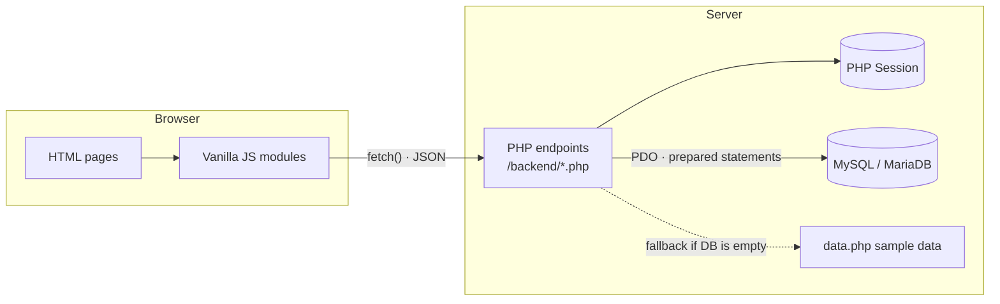
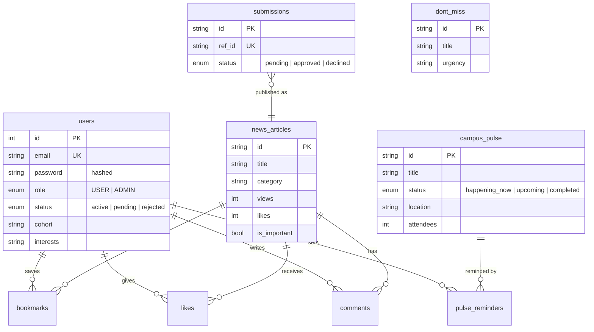

<div align="center">

# 📰 NSBM NewsDesk — Campus Pulse

**One place for campus news, live university activity, and student-written stories.**

Built for the NSBM Green University community · Faculty of Computing · Batch 26.1 IFSL

[](https://campuspulse.infy.click/)
[](https://github.com/Induranga-W/Campus-pulse)


[Features](#-features) ·
[Screenshots](#-screenshots) ·
[Getting Started](#-getting-started) ·
[Architecture](#-architecture) ·
[API Reference](#-api-reference) ·
[Database](#-database-design) ·
[Security](#-security) ·
[Team](#-team)

</div>

---

## 📖 About

University news usually lives in too many places: notice boards, group chats, emails, social pages. **NSBM NewsDesk — Campus Pulse** brings it together on a single web interface:

- 📰 **Campus news & announcements** with search, categories, likes, comments and bookmarks
- 📡 **Campus Pulse**, a live radar of events (Happening Now / Upcoming / Completed) with reminders
- ✍️ **Student submissions**, so students can send in their own stories for editorial review
- 🛡️ **Admin console** for editors to manage news, activities and submissions

It uses a deliberately simple, decoupled stack with **no frameworks and no build step**: plain HTML/CSS/JS on the front, PHP + MySQL on the back, talking over JSON with the Fetch API.

---

## ✨ Features

### For students
| Feature | What you can do |
|---|---|
| **Home** | Personal greeting, important news, Campus Pulse preview, rotating **Don't Miss** announcement banner |
| **For You feed** | Stories filtered by your chosen interests (Events, Academic, Announcements, Campus Life, Technology, Sports) |
| **Latest News** | Live search, category filters, sort by *Newest* or *Most popular* |
| **Article view** | Full story in a modal with view counter, likes and comments |
| **Campus Pulse** | Filter activities by status, see venue / time / organiser / attendance, **set or remove a reminder** |
| **Bookmarks** | Save articles to a personal reading list and remove them later |
| **Submit a story** | Name, email, headline, category, details and optional cover image URL. Each story is saved as *pending* and gets a reference code like `NSBM-SUB-2026-1234` |
| **Accounts** | Register, sign in, profile page with cohort and interest preferences |
| **Responsive UI** | Works on desktop and mobile, with mobile navigation |

### For administrators
| Module | What you can do |
|---|---|
| **Dashboard** | Totals for published articles, pending submissions and active Pulse items, the review queue, and recent articles |
| **News Management** | Create and delete articles, filter by title/author/category |
| **Campus Pulse Radar** | Add activities, remove them, and move status along (`upcoming → happening now → completed`) |
| **Student Submissions** | Review reporter stories and **Approve & Publish** them as live articles |

---

## 🖼️ Screenshots

> Put your screenshots in `docs/screenshots/` and they will show up here. Figures 1–8 in the project report are good candidates.

| Student Home | Latest News |
|:--:|:--:|
|  |  |

| Campus Pulse | Submit a Story |
|:--:|:--:|
|  |  |

| Profile & Bookmarks | Admin Dashboard |
|:--:|:--:|
|  |  |

---

## 🚀 Getting Started

### Prerequisites
- **PHP 7.4+** with the `pdo_mysql` extension (PHP 8.x recommended)
- **MySQL 5.7+ or MariaDB 10.3+**
- Apache (or Nginx) — easiest via **XAMPP** or **WAMP**

### 1. Get the code
```bash
git clone https://github.com/Induranga-W/Campus-pulse.git
```
Place the folder under your web root, e.g. `C:\xampp\htdocs\nsbm-newsdesk` or `/var/www/html/nsbm-newsdesk`.

### 2. Create the database
In phpMyAdmin or the MySQL client:
```sql
CREATE DATABASE `nsbm_newsdesk` DEFAULT CHARACTER SET utf8mb4;
```
Then import the schema, which also loads sample data and demo accounts:
```bash
mysql -u root -p nsbm_newsdesk < database/schema.sql
```
> ⚠️ `schema.sql` starts with `DROP TABLE IF EXISTS …`, so re-importing **wipes existing data**.

### 3. Configure credentials
Defaults are `localhost:3306`, database `nsbm_newsdesk`, user `root`, empty password (stock XAMPP), so a local setup may work as is.

For anything else, **do not edit `config.php`**. Copy the template instead. `config.local.php` is git-ignored, so your real credentials never get committed:
```bash
cp backend/config.example.php backend/config.local.php
```
```php
<?php
define('DB_HOST', 'localhost');
define('DB_PORT', '3306');
define('DB_NAME', 'nsbm_newsdesk');
define('DB_USER', 'your-db-user');
define('DB_PASS', 'your-db-password');
```
Environment variables `DB_HOST`, `DB_PORT`, `DB_NAME`, `DB_USER`, `DB_PASS` are also supported.

### 4. Run it
Start **Apache** and **MySQL**, then open:
```
http://localhost/nsbm-newsdesk/index.html
```

### 🔑 Demo accounts
| Role | Email | Password |
|---|---|---|
| **Admin** | `admin@nsbm.ac.lk` | `Admin@123` |
| **Student** | `kasun@students.nsbm.ac.lk` | `User@123` |

> ⚠️ These are for evaluation only. **Change them, and use strong database credentials, before any real deployment.**

### ☁️ Shared hosting (cPanel / InfinityFree)
1. Upload the project to `public_html`.
2. Import `database/schema.sql` into the hosting database.
3. Create `backend/config.local.php` with the hosting DB host, name, user and password.
4. Visit your domain.

---

## 🏗️ Architecture



### Project structure
```
.
├── index.html            # Student home
├── news.html             # Latest News hub (search, filter, sort)
├── pulse.html            # Campus Pulse radar
├── submit.html           # Story submission form
├── login.html            # Sign in
├── register.html         # Student registration (always creates role USER)
├── profile.html          # Profile + interest preferences
├── bookmarks.html        # Saved articles
├── data.php              # Sample data used when the DB has no rows
│
├── admin/
│   └── dashboard.html    # Staff Administration Console (ADMIN only)
│
├── css/
│   ├── style.css         # Design system: variables, cards, modals
│   ├── header.css        # Navbar, profile badge, dropdown
│   ├── footer.css        # Footer
│   └── admin.css         # Admin tables, metrics, modals
│
├── js/
│   ├── main.js           # Shared UI: carousel, cards, modals, toasts, likes/bookmarks
│   ├── auth.js           # Session check, role-aware profile dropdown, logout
│   ├── news.js           # Latest News: live search + sort
│   ├── pulse.js          # Campus Pulse: filters + reminders
│   ├── profile.js        # Profile page + interests
│   ├── admin.js          # Admin dashboard controller
│   └── admin-requests.js # "Admin Requests" tab (see Roadmap)
│
├── backend/
│   ├── config.php        # Session setup, DB settings, JSON + role helpers
│   ├── config.example.php# Template for config.local.php
│   ├── db.php            # PDO connection (prepared statements)
│   ├── auth.php          # Current-session check
│   ├── login.php         # Login
│   ├── register.php      # Registration
│   ├── logout.php        # Logout
│   ├── news.php          # Articles, search, likes, comments
│   ├── bookmarks.php     # Bookmarks
│   ├── pulse.php         # Activities + reminders
│   ├── submit.php        # Student submissions
│   └── admin.php         # ADMIN-only operations
│
├── database/
│   └── schema.sql        # Tables, constraints, seed data
├── images/               # Campus photos used by seed articles
├── build.js              # Copies deployable files into dist/
└── package_zip.py        # Builds nsbm_newsdesk_campus_pulse.zip
```

### How a request flows
1. A page's JS calls an endpoint with `fetch()`, e.g. `./backend/news.php?category=Events`.
2. The endpoint starts the PHP session, checks the role if needed, and queries MySQL through PDO.
3. It replies with JSON (`{ "success": true, ... }`).
4. The JS renders the result into the page.

> **Fallback data:** if the database is unreachable or a table is empty, several endpoints fall back to `data.php`, so the UI still shows content. This is handy for demos but means an empty page may be sample data rather than live data.

---

## 🔌 API Reference

All endpoints live in `/backend/` and return JSON. Errors use `{ "success": false, "error": "…" }` with an appropriate HTTP status.

| Endpoint | Method | Auth | Description |
|---|---|---|---|
| `auth.php` | GET | — | Returns `{ authenticated, user }` for the current session |
| `login.php` | POST | — | Body: `email`, `password`. Starts a session (ID regenerated) |
| `register.php` | POST | — | Body: `name`, `email`, `password` (min 6 chars), optional `cohort`. Always creates a `USER` and signs them in |
| `logout.php` | POST | — | Destroys the session and cookie |
| `news.php` | GET | — | List articles. Query: `category`, `search`, `sort=newest\|popular` |
| `news.php?id=…` | GET | — | One article plus its comments (increments views) |
| `news.php` | POST | — | `action=like` or `action=comment`, with `article_id` (comment also needs `text`) |
| `bookmarks.php` | GET | USER | The signed-in user's saved articles |
| `bookmarks.php` | POST | USER | Toggle a bookmark: `article_id` |
| `pulse.php` | GET | — | List activities. Query: `status=all\|happening_now\|upcoming\|completed` |
| `pulse.php` | POST | — | Toggle a reminder: `pulse_id` (stored only when signed in) |
| `submit.php` | POST | — | Body: `student_name`, `student_email`, `headline`, `category`, `details`, optional `image_url`. Returns a `ref_id` |
| `admin.php?action=overview` | GET | **ADMIN** | Stats, pending submissions, news and Pulse lists |
| `admin.php` | POST | **ADMIN** | `action` is one of `create_news`, `delete_news`, `approve_submission`, `create_pulse`, `delete_pulse`, `toggle_pulse` |

---

## 🗄️ Database Design



| Table | Purpose |
|---|---|
| `users` | Accounts, role, approval status, cohort, interests |
| `news_articles` | Published stories (content, category, author, views, likes) |
| `campus_pulse` | Campus activities with venue, time, organiser, attendance, status |
| `dont_miss` | Priority announcements for the homepage banner |
| `submissions` | Student stories and where they are in review |
| `bookmarks`, `likes`, `pulse_reminders` | Per-user interactions |
| `comments` | Article comments |

Foreign keys use `ON DELETE CASCADE`, and **unique constraints** `(user_id, article_id)` / `(user_id, pulse_id)` stop a user from bookmarking, liking or setting a reminder on the same item twice.

---

## 👥 User Roles

| Capability | Guest | USER (student) | ADMIN |
|---|:--:|:--:|:--:|
| Browse news and Campus Pulse | ✅ | ✅ | ✅ |
| Submit a story | ✅ | ✅ | ✅ |
| Like and comment | ✅ | ✅ | ✅ |
| Bookmarks, profile, interests | ❌ | ✅ | ✅ |
| Persisted reminders | ❌ | ✅ | ✅ |
| Admin Dashboard and `admin.php` | ❌ | ❌ | ✅ |

The **Admin Dashboard** link only appears in the profile dropdown for admins. The real protection is on the server: `admin.php` calls `require_admin()` first and returns `401` (not signed in) or `403` (not an admin) otherwise.

---

## 🔒 Security

- 🔑 **Password hashing** with `password_hash()` / `password_verify()` (bcrypt)
- 🧱 **PDO prepared statements** with emulation off, so queries are parameterised
- 🪪 **Session authentication**; `session_regenerate_id(true)` after login and registration to prevent fixation
- 🍪 **Cookie flags:** `HttpOnly`, `SameSite=Lax`, and `Secure` automatically on HTTPS
- 🛡️ **Server-side role checks** on every admin operation
- 🚫 **Public registration can only create `USER` accounts**
- 🙈 **Secrets stay out of git:** real DB credentials go in the git-ignored `backend/config.local.php`
- ✅ **Input validation** on required fields, email format and password length

### Before going to production
- [ ] Change or remove the demo accounts in `schema.sql`
- [ ] Use strong, dedicated database credentials
- [ ] Serve the site over **HTTPS**
- [ ] Review PHP session and error-display settings (`display_errors` off)
- [ ] Review the Roadmap items below

---

## 🧪 Testing

Manually verified for each user type:

| Area | Checked | Result |
|---|---|:--:|
| Registration & login | Student sign-up and sign-in | ✅ Passed |
| Access control | A USER cannot reach admin operations | ✅ Passed |
| News search & categories | Search and category filters | ✅ Passed |
| Likes & comments | Adding likes and comments | ✅ Passed |
| Bookmarks | Saving to the reading list | ✅ Passed |
| Campus Pulse reminders | Setting reminders | ✅ Passed |
| Story submission | Submit and `pending` status | ✅ Passed |
| Admin management | News, Pulse items, submissions | ✅ Passed |
| Responsive layout | Desktop and mobile navigation | ✅ Passed |
| Form validation | Required fields and email checks | ✅ Passed |
| Data persistence | Data saved in the database | ✅ Passed |
| Session handling | Behaviour after logout | ✅ Passed |

---

## 📦 Packaging

```bash
node build.js        # runs package_zip.py, then copies deployable files to dist/
python3 package_zip.py   # just creates nsbm_newsdesk_campus_pulse.zip
```
`dist/` and `*.zip` are git-ignored.

---

## 🛣️ Roadmap & Known Limitations

Being upfront about what is still rough, which is useful for reviewers and future contributors:

- **Admin approval workflow:** the schema (`users.status`) and the *Admin Requests* tab (`js/admin-requests.js`) are in place, but `backend/admin.php` does not yet implement the `pending_admins`, `approve_admin` and `reject_admin` actions, and the sign-in/registration pages do not yet offer admin sign-up. Until then, admins are created directly in the database.
- **Likes and comments from guests** are accepted. Consider requiring sign-in.
- **No CSRF tokens** yet; sessions rely on `SameSite=Lax`.
- **Several client-side preferences** (interests, bookmarks, likes, reminders) are also cached in `localStorage` for speed, so they can differ from the database across devices.
- **Admin writes report success** even if the database call fails (errors are only logged), so surface failures in the UI.
- **Pulse times are free-text** strings rather than real date/time columns, so there is no automatic status change.
- Ideas: image upload instead of URL, pagination, email notifications for approved submissions, rich-text editor for admins.

---

## 👨‍💻 Team

**Faculty of Computing, NSBM Green University — Web and Mobile Application Development, Batch 26.1 IFSL**
*Topic 1: Campus News & Information System*

| Member | Student ID | Role |
|---|:--:|---|
| **W.M.P.D. Induranga** (Team Leader) | 41722 | Project Lead & Authentication |
| Nimsara I G S | 42117 | Front-End Lead |
| H.M.I.S. Herath | 41916 | Database & User Accounts Engineer |
| S P T Thewjan | 42116 | Landing Page & News Platform Owner |
| U G H Yashasvi | 42141 | Data & Interactions Developer |
| M.K.H.B. Kumara | 42109 | Build / DevOps & Admin Integration Lead |

---

## 🔗 Links

- 🌐 **Live app:** https://campuspulse.infy.click/
- 💻 **Repository:** https://github.com/Induranga-W/Campus-pulse

---

<div align="center">

© 2026 NSBM Green University Town · Faculty of Computing (Batch 26.1 IFSL)
Made with ☕ in Pitipana, Homagama, Sri Lanka.

</div>